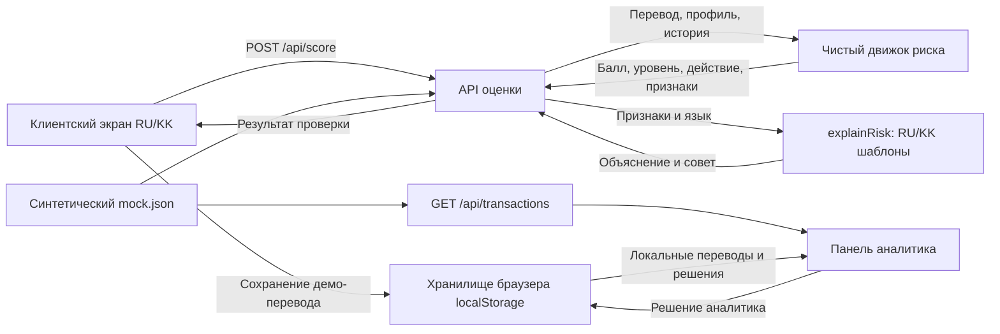

# SafeTransfer

**Защита денежного перевода до отправки: понятный риск для клиента и рабочее место для банковского аналитика.**

*Қауіпсіз аударым — түсінікті шешім.*

MVP для кейса BCC Bank на V Regional ITU Hackathon 2026. Это работающая демонстрация на синтетических данных, а не подключённый к банку платёжный сервис.

## Проблема

При мошенничестве клиент может сам подтвердить перевод под давлением или обманом. Обычное подтверждение показывает факт согласия, но не объясняет, почему новый получатель, непривычная сумма или серия операций требуют внимания. Аналитику нужны причины риска и контекст клиента, чтобы быстро проверить подозрительную операцию.

## Решение

SafeTransfer оценивает перевод до отправки, показывает риск от **0 до 100**, объясняет обнаруженные признаки простыми словами и предлагает действие: разрешить, дополнительно подтвердить или приостановить. Аналитик видит ту же оценку и причины, сравнивает перевод с обычным поведением клиента и принимает отдельное решение.

В текущем MVP оценка рассчитывается **детерминированными правилами**, а объяснения — **локальными шаблонами**. Обученной ML-модели и вызовов LLM сейчас нет; это направления развития, а не уже реализованные возможности.

## Что можно показать жюри

- **Экран клиента `/`:** сумма в KZT, знакомый или новый получатель, проверка через API с задержкой ввода 400 мс, шкала риска, понятные причины и совет против мошенничества. Для демонстрации можно выбрать новое устройство и ночное время.
- **Решения до отправки:** низкий риск — успешный демо-перевод; средний — отдельное подтверждение; высокий — только отмена или запрос проверки банком. Кнопки «отправить всё равно» при высоком риске нет.
- **Панель банка `/dashboard`:** очередь подозрительных операций, фильтры и сортировка, карточка с причинами риска и сравнением поведения, подтверждаемые решения «Заблокировать» / «Разрешить», показатели и графики.
- **Общая демо-история:** новые переводы появляются в панели без перезагрузки при работе в другой вкладке того же браузера и на том же адресе. Хранящиеся в браузере решения обновляют статус, сохраняя исходный риск.
- **RU/KK:** русский по умолчанию и казахский интерфейс, включая объяснения, сообщения, заголовки страниц и страницу 404. Мобильный интерфейс использует карточки и нижнюю панель действия; риск обозначается цветом, значком и текстом.

## Архитектура



Движок находится в [`web/lib/risk-engine.ts`](web/lib/risk-engine.ts): чистая функция `scoreTransaction(input, customer, history, recipients)` не меняет входные данные и не обращается к сети. `/api/score` подставляет демо-профиль и серверную синтетическую историю, вызывает движок и [`explainRisk`](web/lib/explain.ts).

Панель объединяет API-историю, новые клиентские записи и решения аналитика по ID. Запись из браузера имеет приоритет над одноимённой API-записью, затем решение аналитика меняет только статус: `block → blocked`, `allow → completed`. Новые локальные переводы **не добавляются в серверную историю скоринга**. Приоритеты и показатели реализованы в [`dashboard-data.ts`](web/lib/dashboard-data.ts); сохранение клиента — в [`store.ts`](web/lib/store.ts).

## Реальные правила риска

Источник весов и порогов — экспортируемый `RISK_CONFIG` в [`risk-engine.ts`](web/lib/risk-engine.ts).

| Признак | Условие | Вес |
| --- | --- | ---: |
| Новый получатель | ID отсутствует среди знакомых получателей клиента | +20 |
| Сумма выше обычной | Отношение к средней сумме строго больше 3 и не больше 8 | +15 |
| Очень большая сумма | Отношение строго больше 8; заменяет предыдущий вес, а не складывается с ним | +30 |
| Необычное время | Вне обычных часов клиента, время `Asia/Almaty` | +10 |
| Новое устройство | ID отсутствует среди знакомых устройств | +15 |
| Частые переводы | Не менее 3 операций за 10 минут, включая текущую | +20 |
| Подозрительный получатель | `flagged: true` в демо-справочнике | +40; итог не ниже 85 |
| Сумма чуть ниже порога | От 475 000 ₸ включительно до 500 000 ₸ исключительно | +10 |

В таблице восемь строк: сумма имеет две взаимоисключающие градации. Типов признаков — семь. Итоговая сумма ограничена **100**. Порог **500 000 ₸** выбран для демонстрации дробления переводов и не является нормативным банковским лимитом.

| Итог | Уровень | Действие |
| --- | --- | --- |
| Меньше 30 | Низкий / `low` | `allow` — выполнить демо-перевод |
| От 30 до 59 | Средний / `medium` | `confirm` — запросить подтверждение |
| От 60 | Высокий / `high` | `hold` — приостановить |

Начало обычного временного диапазона включено, конец исключён; ночные диапазоны поддерживаются. Для частоты учитываются предыдущие попытки этого же клиента независимо от статуса, включая границу 10 минут. Будущие записи и запись с ID текущего перевода исключаются. Минимум 85 для подозрительного получателя объясняет, почему итог может быть выше суммы отдельных признаков.

## Как работают объяснения

Каждый признак содержит ID, вес и параметры: сумму, среднее, отношение сумм, час или число переводов. [`web/lib/explain.ts`](web/lib/explain.ts) подставляет их в словари [`i18n.ts`](web/lib/i18n.ts) и возвращает итоговое объяснение, список причин и **один совет по наиболее весомому признаку**. При равных весах выбирается первый признак в стабильном порядке движка; если признаков нет, используется общий совет.

Тексты воспроизводимы, не требуют внешнего AI API и не обещают полной безопасности. Скоринговый балл — не вероятность мошенничества: например, 85 не означает доказанную вероятность 85%.

## Данные и ограничения

Генератор [`web/scripts/generate-mock.ts`](web/scripts/generate-mock.ts) создаёт **8 клиентов, 20 получателей, из них 3 с флагом, и 300 переводов**. Все имена, счета, балансы и операции демонстрационные; счета обозначены `DEMO`. Постоянные seed `20261115` и опорное время `2026-11-15T12:00:00.000Z` делают результат повторяемым. Операции находятся в предшествующем 30-дневном интервале; 30 операций участвуют в заданных подозрительных сценариях. Это **не размеченная выборка для оценки точности**: первые операции серии ещё не достигают порога частоты.

- Нет реальной банковской интеграции, списаний, базы данных, серверного аудита и полноценной аутентификации/разграничения доступа.
- Добавленные переводы и решения хранятся в `localStorage` текущего браузера. Это не надёжное банковское хранилище; данные можно изменить или удалить. При запрете хранилища показывается предупреждение, остаётся резерв на текущую сессию.
- Демо-форма отправляет параметры в API самого приложения для проверки; нельзя утверждать, что данные вообще не покидают браузер. Внешние ML/LLM-сервисы не вызываются. Вводить настоящие персональные данные и реквизиты не нужно.
- Веса и пороги заданы вручную; точность, полнота, частота ложных тревог и эффект на реальные потери не измерялись на банковских данных.
- Показатель суммы в панели — сумма статусов `held` и `blocked`, без `pending_review` и `completed`. Это демо-показатель, а не доказанные предотвращённые потери. График по дням охватывает 30 дней до самой новой операции в данных, остальные агрегаты — всю объединённую историю.
- Решение аналитика может разрешить высокорисковый демо-перевод после подтверждения. Исходная оценка при этом сохраняется.

## Масштабирование: следующий этап

1. **Интеграция через API:** адаптер банковского процессинга передаёт профиль и контекст до исполнения операции. Потребуются серверные данные, авторизация, идемпотентность, журнал решений и согласованный режим при недоступности проверки. Нынешний endpoint работает с mock-историей и не готов к прямому промышленному подключению.
2. **История и нагрузка:** перенести состояния из браузера на сервер, считать оконные признаки потоком и хранить агрегаты. Сейчас движок линейно просматривает переданную историю; банковскую пропускную способность мы не заявляем.
3. **Правила плюс ML:** дополнить прозрачные правила моделью на законно подготовленных размеченных данных. Сначала сравнить качество и ложные срабатывания на отложенной выборке, затем проверить задержки, дрейф и стоимость ошибок в пилоте.
4. **LLM-объяснения в будущем:** генерировать текст только из подтверждённых признаков с защитой персональных данных и проверкой содержания. Модель не должна менять решение или придумывать причины; текущие шаблоны останутся резервным вариантом.

## Технологии

Next.js 16.4.6 (App Router и Route Handlers), React 19.3.0, TypeScript, Tailwind CSS 4.3.3, Vitest 4.1.12. Графики и иллюстрации — SVG/CSS без UI- или графических библиотек. Inter размещён локально через `next/font/local`; лицензия находится в [`web/app/fonts/LICENSE.txt`](web/app/fonts/LICENSE.txt).

## Запуск и проверки

Нужны **Node.js 24+** и npm. Из корня репозитория:

```bash
cd web
npm install
npm run dev
```

Откройте http://localhost:3000 — клиент; http://localhost:3000/dashboard — панель банка. Демо не требует ключей и `.env` со значениями; `web/.env.example` содержит только комментарий. Файлы `.env*`, кроме `.env.example`, игнорируются Git.

Проверки из `web/`:

```bash
npm run lint
npm test
npm run build
```

Запуск production-сборки после `npm run build`:

```bash
npm start
```

Пересоздать те же синтетические данные из `web/`:

```bash
npm run generate:mock
```

Команда запускает TypeScript напрямую через Node.js; `tsx` и внешние генераторы данных не нужны. Тесты проверяют логику и границы правил, объяснения, данные, хранение, фильтры, локализацию и контраст. Их прохождение не доказывает точность антифрода на реальных операциях.

## Четыре сценария демонстрации

Названия в первой колонке — **видимые подписи кнопок** в RU. Каждая выбирает профиль **Айгерім С.** и фиксированное время; текущие дата и час не меняют результат.

| Кнопка | Сумма | Реальные признаки | Балл и уровень | Что увидит клиент |
| --- | ---: | --- | --- | --- |
| «Обычный перевод» | 20 000 ₸ | Нет | **0 — низкий (`low`)** | После «Продолжить» — «Перевод выполнен» |
| «Ночью · новому» | 240 000 ₸ | Новый получатель +20, сумма в 12 раз выше средней +30, необычный час +10 | **60 — высокий (`high`)** | «Перевод приостановлен»: отмена или проверка банком |
| «Подозрительный счёт» | 20 000 ₸ | Новый получатель +20 и флаг +40; минимум 85 | **85 — высокий (`high`)** | Отмена или «Попросить банк проверить» |
| «Серия переводов» | 20 000 ₸ | Частота +20 и новое устройство +15 | **35 — средний (`medium`)** | «Давайте перепроверим»: подтверждение или отмена |

Для доступности длинные названия второго и четвёртого сценариев — «Крупный ночной перевод новому человеку» и «Много быстрых переводов». Частота сама по себе даёт только 20; средний риск в последнем сценарии создаёт сочетание с новым устройством. Запрос проверки сохраняется как `pending_review`, а не отправляет деньги.

[Сценарий показа на 3 минуты и питч на 5 минут](docs/DEMO_SCRIPT.md) · [Ответы на вопросы жюри](docs/QA_FOR_JURY.md)

## Скриншоты

Места для четырёх изображений перед отправкой заявки; файлы пока не приложены:

| Изображение | Что должно быть видно |
| --- | --- |
| 1. Клиентский экран — **[добавить изображение]** | RU, обычный перевод, форма и шкала 0/низкий рядом |
| 2. Приостановленный перевод — **[добавить изображение]** | Высокий риск, объяснение, совет и действия без «отправить всё равно» |
| 3. Панель аналитика — **[добавить изображение]** | Показатели, графики, очередь и карточка с подтверждением решения |
| 4. Мобильный интерфейс KK — **[добавить изображение]** | Казахские подписи, нижняя панель риска/действия и отсутствие горизонтальной прокрутки |
